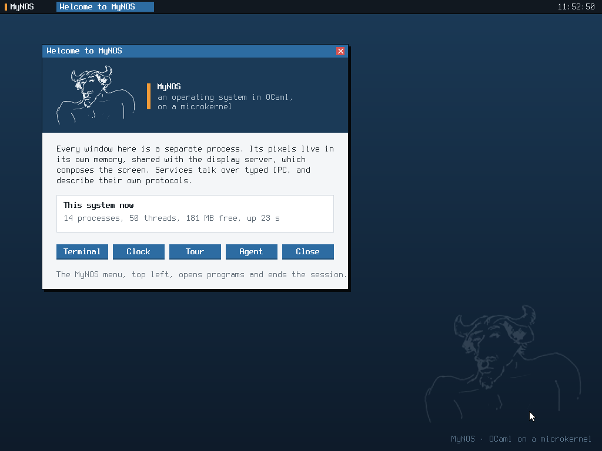
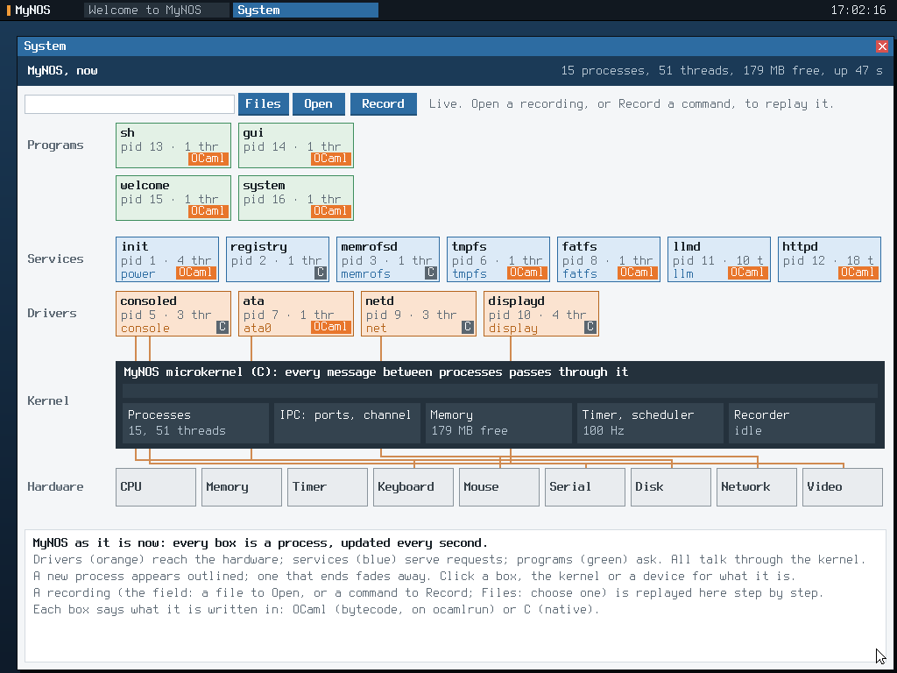
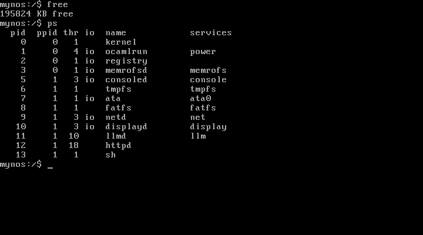

<p align="center">
  
</p>

# MyNOS

> The MyNOS project aims at developing a new and different operating
> system, based on high-level languages. MyNOS will be based on the
> OCaml bytecode interpreter. We'd like to explore microkernel
> architecture and new language definition too.

MyNOS is an experimental operating system for 32-bit x86, written between 2002
and 2004, and taken up again in 2026 with the help of AI. It consists of a
small microkernel in C and assembly, with drivers and services running as user
processes, and the OCaml bytecode interpreter ported to run on top of it. The
long-term goal was an OS whose programs are written in a high-level language
rather than in C.

## Try it

Download `mynos-VERSION.tar.gz` from the
[Releases](https://github.com/ctrl-z-bg/mynos/releases) page, install
QEMU (`apt install qemu-system-x86`, `brew install qemu`...), and:

```
tar xzf mynos-*.tar.gz && cd mynos-*/ && ./run-mynos.sh
```

MyNOS boots in a few seconds; `help` lists the commands, `gui` starts
the graphical session, and its Tour explains how the system works. The
manual is in [`doc/manual/`](doc/manual/README.md); building from source
is described below.

## Screenshots

The graphical session as it starts: every window is a separate process,
drawing in its own memory, which it shares with the display server.



The System window draws the architecture as it is at that moment, from the
hardware up: the microkernel, the drivers, the services and the programs
running, each one a process (and what it is written in, OCaml or C). A
recording of the event recorder can be replayed on it, a message at a time,
as arrows from one process through the kernel to another.



The text console: the shell, written in OCaml, and its processes.



`tools/screenshots.sh` takes them again.

## What's inside

| Directory | Contents |
|---|---|
| [`mynos-core/`](mynos-core/) | The microkernel: multiboot boot, paging, processes and threads, copy-on-write fork, scheduler, semaphores, port/channel IPC, user-space IRQ delivery, native (`int 0x90`) and Linux-compatible (`int 0x80`) syscalls |
| [`mynos-lib/`](mynos-lib/) | User-space library for the native syscalls (`include/mynos.h`), and the OCaml library `Mynos` (`ocaml/`) |
| [`services/`](services/) | User-space servers: name registry, console (keyboard, layouts, line editing, the serial port as a terminal), file systems (`memrofs`, `tmpfs`, `fatfs`), the ATA disk driver, the network (`netd`: lwIP, TLS), language models (`llmd`) |
| [`mynos-runtime/`](mynos-runtime/) | The OCaml 5.5 bytecode runtime for MyNOS: the upstream runtime, unchanged, plus a MyNOS `main()` |
| [`init/`](init/) | `init`, in OCaml: starts the services and the shell listed in `init.rc` |
| [`shell/`](shell/) | The shell: the OCaml toplevel, with a few commands (`ls`, `cat`, `run`) and the MyNOS API |
| [`system/`](system/) | The system RAM disk: init, its configuration, services, the shell, programs |
| [`doc/STATUS.md`](doc/STATUS.md) | Architecture overview and current state of the project |
| [`doc/JOURNAL.md`](doc/JOURNAL.md) | Engineering journal: what was found while reviving the code, bug by bug |
| [`doc/decisions/`](doc/decisions/) | Design decisions, with the evidence behind them |

Low-level design notes from 2002 (memory layout, interrupts, startup) are in
[`mynos-core/doc/MyNOS-note.txt`](mynos-core/doc/MyNOS-note.txt).

## How it works, in short

GRUB loads the kernel together with a set of modules. The kernel starts every
ELF module as a user process: the services and `ocamlrun`. User programs are
static Linux i386 binaries (built with [musl](https://musl.libc.org/) today,
with [dietlibc](https://www.fefe.de/dietlibc/) originally). The kernel
implements just enough of the Linux syscall interface for them to run
unmodified, while MyNOS-specific features (IPC, ports, semaphores, IRQs,
threads, starting programs) go through `libmynos`, which also turns file and
keyboard I/O into IPC with the filesystem and console services. `ocamlrun`
then runs `init.byte` from the RAM disk: `init`, written in OCaml, which
starts the services and `sh`, a command shell in OCaml; `ocaml` opens the
OCaml toplevel, where the system is programmable in OCaml.

```
mynos:/$ cd /disk; edit hello.ml
mynos:/disk$ ocamlc -o hello.byte hello.ml && ./hello
mynos:/disk$ ocaml
OCaml version 5.5.2
# let rec fact n = if n = 0 then 1 else n * fact (n - 1);;
val fact : int -> int = <fun>
# fact 10;;
- : int = 3628800
# run "hello.byte" [];;
Hello from OCaml on MyNOS!
...
- : Mynos.status = Mynos.Exited 0
```

See [`doc/STATUS.md`](doc/STATUS.md) for details.

## Building

The system is 32-bit: user programs are static Linux i386 binaries (musl)
and the OCaml runtime is 5.5, built for that target. Current distributions
don't provide this for an x86_64 host. Builds run in containers
with [podman](https://podman.io/); QEMU runs on the host.

```sh
tools/containers/build-image.sh dev      # once: build the image
tools/build-all.sh                       # build everything in the container
tools/run-demo.sh                        # boot MyNOS in QEMU, into the shell
```

The build environment is a container with gcc 14, musl and OCaml 5.5
(Debian trixie i386). The original project's toolchain (gcc 4.3, dietlibc,
OCaml 3.06 in `mynos-byterun/`, Debian lenny) was kept alongside until
2026-11-18: the last commit it builds is tagged `legacy-last`, and the
original code, as of 2008, `legacy-2008`.

`tools/run-tests.sh` boots the system headless and checks its output.
`tools/in-container.sh dev` opens a shell in the build environment, or runs
the command given after it. `tools/run-qemu.sh` boots the kernel with any
list of modules (`"path args"` passes arguments); without modules it boots
the standard system, like `tools/run-demo.sh`. See the scripts for details.

## Using it

`tools/run-demo.sh` opens QEMU's window on MyNOS's shell; `help` lists the
commands. `/disk` is a FAT disk image (`system/disk.img`) kept across
boots; `/tmp` is in memory; `/` is the read-only RAM disk. `shutdown`
turns the machine off (QEMU ends), `shutdown -r` restarts it; `gui`
starts the graphical session.

**The console.** Shift + Page Up / Page Down scroll back through the
lines that went off the screen (500 are kept). Accented letters are
shown (UTF-8). `keymap it` switches the keyboard to the Italian layout,
with AltGr (or Ctrl + Alt) for `@ # [ ] { } ~ €`; `keymap us` switches
back, and the choice is remembered on `/disk`.

**Copy and paste with the host.** QEMU's window cannot paste. Instead,
make your terminal a console of MyNOS too:

```sh
SERIAL=1 tools/run-demo.sh                   # the window, and this terminal
SERIAL=1 tools/run-demo.sh -- -display none  # this terminal only
```

The terminal is connected to MyNOS's second serial port: copy, paste
(several lines run one after the other), scrollback and accented letters
are your terminal's. Ctrl-C goes to MyNOS; Ctrl-A then X stops QEMU.
Kernel and service messages show there too, and full-screen programs
(`edit`, `kilo`) want a terminal of 80 x 25.

**Language models** (optional; [`doc/decisions/llm.md`](doc/decisions/llm.md)).
Copy [`llm.env.example`](llm.env.example) to `llm.env` (ignored by git),
put your keys in it, and `tools/run-demo.sh` copies it into the disk as
`/disk/llm.env`. Claude and any server speaking OpenAI's Chat Completions
(OpenAI, vLLM, Ollama on the host at `10.0.2.2`) can be configured. Then,
in the shell:

```
llm -l                                  # the configured models
llm Which year was OCaml born?          # a question
ask list the files in /disk with their sizes    # a command, run if you agree
agent Write the IP address of MyNOS in /disk/ip.txt
```

`agent` carries out a task with tools (commands, files, OCaml programs
type-checked before they run, the system's typed services), and asks
before anything that changes things (y, n, or a for yes to all). It
records what the system did meanwhile: `trace calls /tmp/agent.trc`. In
the graphical session, the menu's Agent opens the same agent in a window:
its confirmations are buttons, and a follow-up continues the
conversation; Recordings shows a recording as a timeline of calls; System
draws MyNOS's architecture live (the hardware, the kernel, the drivers,
services and programs that are running) and replays a recording on it,
as arrows through the kernel. `ps` lists the processes and their
services; Tour has lessons on how an operating system works, each a
command replayed in the System window with words at each step it explains;
Files browses `/`, `/tmp` and `/disk` (and says which service
serves each); `PROGRAM &` leaves one running, `kill PID` (or the name of
its service) ends it. The top bar has a tab for each window.

## Status

Development stopped at the end of 2004, after the IPC, threads, copy-on-write
and the bytecode interpreter port were in place. In 2026 the project was taken
up again with the help of AI (Claude, through Claude Code): the original system
was rebuilt, ported to a modern toolchain and moved to OCaml 5.5; it runs
again in QEMU, and boots into a command shell, with the OCaml toplevel, an
editor and the OCaml compiler inside. Services are written in OCaml too
(the disk driver, the FAT file system, a web server, the language model
service), over typed IPC; the network has TCP, UDP and TLS. The current
state, known issues and a work log are kept in
[`doc/STATUS.md`](doc/STATUS.md); what was found on the way, bug by bug and
decision by decision, in [`doc/JOURNAL.md`](doc/JOURNAL.md).

## Authors

[Cesare Zavattari](https://github.com/bradstallion),
[Alessandro Tommasi](https://github.com/aaaaale) and
[Tommaso Schiavinotto](https://github.com/Teudimundo). Originally hosted on
SourceForge (`sourceforge.net/projects/mynos`).

Some code in `mynos-core/kernel/idt.[hc]` and `pic.[hc]` is derived from
gazos-0.2 by Gareth Owen (see [`mynos-core/CREDITS`](mynos-core/CREDITS)).
`mynos-core/kernel/3parts/` contains code taken from other projects, such as
the delay loop calibration by Ramon van Handel. The OCaml runtime (OCaml
5.5's, built in the container and linked in `mynos-runtime/`) is by Xavier
Leroy and others, © INRIA.

## License

MyNOS code is released under the GNU General Public License, version 2 or
(at your option) any later version. The OCaml runtime keeps its own license,
the GNU Lesser General Public License with the OCaml linking exception; the
code under `third_party/` keeps its own (see each directory's README). See
the header of each source file.
