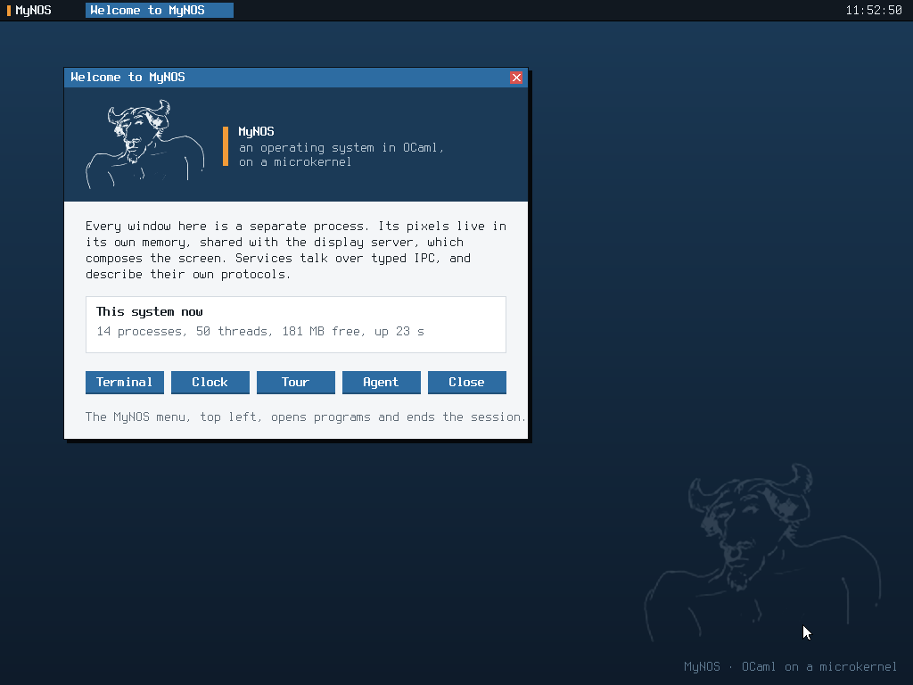
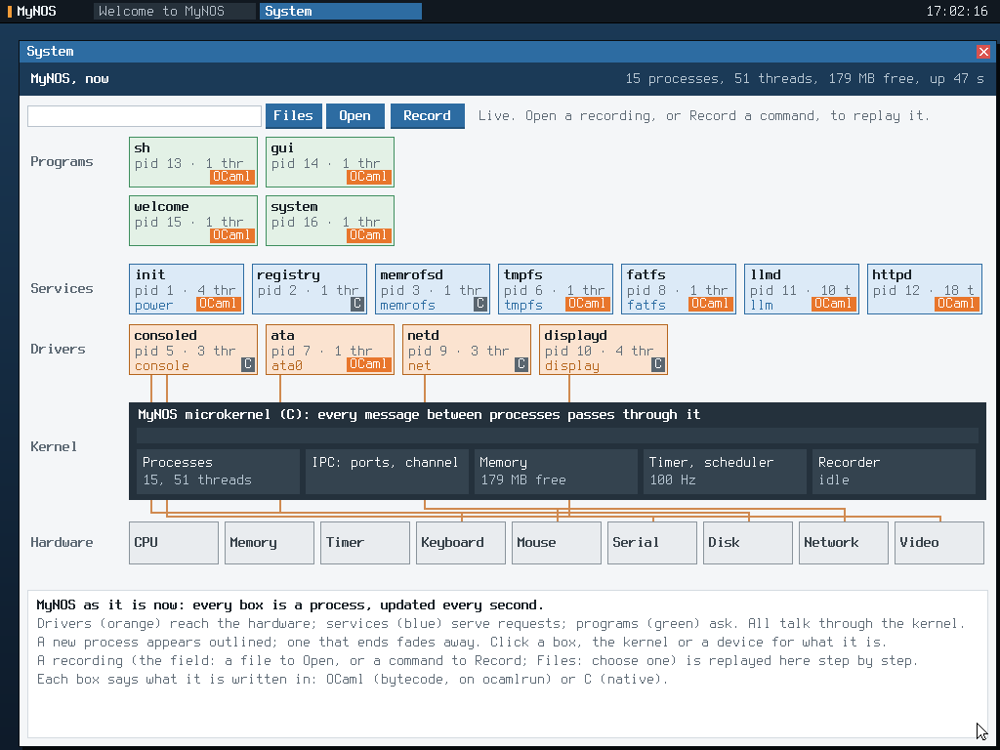

# 10. The Graphical Session

MyNOS has windows. They are not the system's main face: MyNOS starts at
the text console, and the graphical session is a program you start from
it, and leave, coming back to the console as you left it. This chapter
goes through the session one step at a time: starting it, the screen,
the MyNOS menu, windows and tabs, then each program of the menu, and
how to leave. Chapters 11 and 12 come back to the windows that watch the
system and talk to language models.

## 10.1 Step 1: starting the session

At the prompt, type `gui`:

```
mynos:/$ gui
```

The screen turns graphical (1024 x 768 pixels) and the welcome window
opens (figure 10-1). `gui` waits, in the text console, until the session
ends. The display server, `displayd`, needs QEMU's standard VGA card,
which `tools/run-demo.sh` gives; without it, `gui` says `gui: no display
service (displayd: QEMU's standard VGA is needed)`.



*Figure 10-1. The welcome window.*

The welcome window says what MyNOS is, how many processes and threads
are running, how much memory is free and how long the system has been
up. Its buttons open a Terminal, a Clock, the Tour and the Agent; Close
closes it.

## 10.2 Step 2: the screen

```
 ┌────────┬──────────────┬──────────────┬─────────────────────┬──────────┐
 │▌MyNOS  │ Welcome to.. │ Terminal     │                     │ 10:51:38 │  the top bar
 ├────────┴──────────────┴──────────────┴─────────────────────┴──────────┤
 │   ┌─ Welcome to MyNOS ─────────────[x]┐                               │
 │   │                                   │      the desktop              │
 │   │           a window                │                               │
 │   └───────────────────────────────────┘                               │
 │                                                       (the logo)      │
 └───────────────────────────────────────────────────────────────────────┘
   the MyNOS menu    a tab for each window, in the order they opened   the clock (UTC)
```

The **top bar** has, from the left: the **MyNOS menu**; a **tab** for
each window, the focused one lit; and a clock, in UTC. The rest is the
**desktop**, with the project's logo, a Minotaur from the 2003 website,
faint in its corner.

The pointer follows the mouse. In QEMU's window the mouse is not
captured: it moves in and out of the window freely (QEMU's `vmmouse`).

## 10.3 Step 3: the MyNOS menu

Click **MyNOS**, top left. The menu opens:

| Item | Opens |
|---|---|
| Terminal | a terminal window with its own `sh` (10.6) |
| Welcome | the welcome window (10.1) |
| Clock | a clock (10.7) |
| Services | the service explorer (10.8) |
| Agent | the agent's window (10.12, chapter 12) |
| Recordings | the recordings of the event recorder (10.10, chapter 11) |
| System | the system as it runs (10.11, chapter 11) |
| Files | the file manager (10.9) |
| Tour | lessons on how an operating system works (10.13, chapter 11) |
| Exit | ends the session: back to the text console (10.15) |
| Shut down | turns the machine off (10.15) |

Click an item to start it; a click anywhere else closes the menu. Each
item starts a new program, so choosing Clock twice gives two clocks.

## 10.4 Step 4: windows and tabs

Every window has a title bar, with a close box at its right:

```
   ┌─ Terminal ────────────────────────────[x]┐   ◄── drag the title bar to move it
   │                                          │       [x]: close (on release)
```

- **Focus.** A click in a window brings it to the front and gives it the
  keyboard. Everything typed goes to that window, Ctrl-C included.
- **Moving.** Drag a window by its title bar.
- **Closing.** Press the close box and release on it: the window closes.
  If you slip off it before releasing, nothing happens.
- **Tabs.** A click on a window's tab in the top bar brings it to the
  front, wherever it is: a window hidden under others is found without
  moving them. Tabs keep their order.
- **The wheel** scrolls the window under the pointer, focused or not.

Windows open in a cascade, a little to the right of and below the last
one. A window whose program ends disappears within a second.

## 10.5 The welcome window

Described in 10.1. It is the first window `gui` opens; the menu's
Welcome opens another.

## 10.6 The Terminal

The menu's **Terminal** opens a window with `sh` running in it, as at the
text console: 80 columns by 25 lines, the same commands, the same line
editing.

```
mynos:/$ ps
  pid  ppid thr io  name            services
  ...
   48    10   4     terminal        term48
   49    48   1     sh
```

The terminal is itself a small console service, registered as
`term` followed by its pid: `sh` and the programs it starts read their
keys from it and write to it, not to the text console. Full-screen
programs such as `edit` run in it too.

- **Scrolling back.** The last 1000 lines that went off the top are
  kept. The wheel, or a drag on the bar at the right, scrolls back; a key
  brings the view to the bottom again.
- **Ctrl-C** ends the program `sh` is waiting for.
- **Leaving.** `exit` in the terminal ends `sh` and closes the window.
  Closing the window while `sh` runs is a hang-up: `sh`, and what it
  started, end with it. A program that has left `sh`'s family (a service
  an agent started, for example) keeps running.

A graphical program started from a terminal (`/clock.byte`, or your own
with `&`) opens its window in the session.

## 10.7 The Clock

A round clock with three hands, the time in figures under it, in UTC.
It redraws itself every second. Close it with its close box.

## 10.8 Services: a form for any request

The **Services** window shows MyNOS's typed services, the requests each
understands, and lets you send any of them, without knowing anything in
advance. It works this way because each service **describes its own
protocol** (chapter 17): the window asks for the description and builds
a form from it.

**Step 1.** Open the menu's Services. On the left are the services that
answered: `display`, `net`, `llm`, `ata0`.

**Step 2.** Click `net`. The middle column lists the requests of
`net/1`: `config`, `ping`, `resolve`, then the others, marked `*`.
A `*` means the request **changes things** (opens a connection, sends
data); the others only read.

**Step 3.** Click `resolve`. On the right: what it does ("A host name's
IPv4 address (DNS)"), and a field for each argument, with its type:
`name (string)`.

**Step 4.** Click in the field, type `example.com`, click **Call**. The
reply appears below, as JSON:

```
Reply
"172.66.147.243"
```

A request without arguments says `(no arguments)`; `net`'s `config`, so
called, gives the same facts as `ifconfig`. A refused request shows
**Error** and the service's message, in red. Fields are typed as their
types say: an `integer` field must hold a number; a field of a
structured type takes JSON.

The window asks every service the registry knows (but the terminal
windows' consoles), each one about its protocol: `ata0`, `console`,
`display`, `fatfs`, `llm`, `memrofs`, `net`, `power`, `registry`,
`tmpfs`, and any service of your own. The agent can use them too
(chapter 12).

## 10.9 Files, and the file picker

The menu's **Files** is a file manager:

```
 ┌─ Files ──────────────────────────────────────────────────────────────┐
 │ Files  /disk                                                         │
 │┌ Places ─────────┐ [Up][Open][New folder][Rename][Delete][Copy][Cut] │
 ││ /     RAM disk  │ [Paste][Refresh]                                  │
 ││ /tmp  memory    │ docs/                                     folder  │
 ││▐/disk FAT disk ▌│ hello.txt                                   23 B  │
 ││                 │ llm.env                                    310 B  │
 ││ /disk: the FAT  │ ...                                               │
 ││ disk, kept      ├───────────────────────────────────────────────────┤
 ││ across boots.   │ /disk/hello.txt: 23 B: Open shows it              │
 ││ Served by fatfs │                                                   │
 ││ (pid 22, OCaml);│                                                   │
 ││ its blocks come │                                                   │
 ││ from ata0 ...   │                                                   │
 │└─────────────────┘                                                   │
```

**Step 1.** Click a place on the left: `/` (the RAM disk), `/tmp` (in
memory) or `/disk` (the FAT disk). Under the places, the window says
**which process serves the files you see**, its pid, and whether it is
written in OCaml or in C: in MyNOS a file is what a service gives over
IPC.

**Step 2.** Click a name to choose it; the line at the bottom says what
it is and what Open will do. Click it again (or Open, or Enter) to open
it:

| What | Open does |
|---|---|
| a folder | enters it (Up, or Backspace, goes back up) |
| a program, `.byte` | starts it |
| a recording, `.trc` or `.trace` | shows it in the Recordings window |
| a `.pgm` image | shows it in the window |
| text | shows it in the window (Back returns to the list) |
| anything else | says it is not text |

**Step 3.** To change things: **New folder** and **Rename** ask for a
name at the bottom (Enter or OK); **Delete** asks first ("It cannot be
undone"); **Copy** or **Cut**, then go to another folder and **Paste**.
Moving a file between `/tmp` and `/disk` is a copy then a removal, since
two different services keep them. Folders cannot be copied yet. `/` is
read-only: changes there fail with the service's message.

Names starting with `.` are shown, unlike in `ls`.

**The file picker.** Recordings and System have a **Files** button that
opens a picker over their window, to choose a recording:

```
 ┌─ Open a recording ────────────────────────────────┐
 │ [/] [/tmp] [/disk] [Up]                 [Filtered] │
 │ / › tmp                                            │
 │   agent.trc                               47 KB    │
 │   last.trace                              12 KB    │
 │ /tmp/agent.trc                  [Cancel] [Open]    │
 └────────────────────────────────────────────────────┘
```

The three places, Up, and the path, each part of which is a link. Only
folders and the files that fit are listed (here `.trc` and `.trace`);
**Filtered** becomes **All files** at a click. A click enters a folder or
chooses a file; a second click, Open or Enter picks it; Cancel or Escape
gives up. While the picker is open, the rest of the window does not
react.

## 10.10 Recordings

The menu's **Recordings** opens a recording of the event recorder: by
default the agent's last (`/tmp/agent.trc`), else `trace`'s last
(`/tmp/last.trace`). It shows who called whom, when, and for how long,
as a timeline or as a list. Chapter 11 explains it.

## 10.11 System

The menu's **System** draws MyNOS as it is at this moment: the hardware
at the bottom, the kernel, then the drivers, the services and the
programs, one box per process (figure 10-2). A recording can be replayed
on it, message by message. Chapter 11 explains it.



*Figure 10-2. The System window. Every box is a process; orange ones
reach the hardware themselves; each says what it is written in.*

## 10.12 Agent

The menu's **Agent** (or the welcome window's button) opens a
conversation with the agent of chapter 12: you type a task at the
bottom, and confirm with buttons what it wants to do. Chapter 12, 12.7.

## 10.13 Tour

The menu's **Tour** lists lessons on how an operating system works, each
a command recorded and replayed in the System window with words at each
step. Chapter 11, 11.6.

## 10.14 Graphical programs outside the session

A graphical program started from the text console, where there is no
session, says so and ends (exit status 2):

```
mynos:/$ clock
clock.byte: no graphical session: start it with gui.
A graphical program: start the graphical session (gui), then run it from a Terminal window, from Files, or with &.
```

Inside the session, start one from a Terminal window, from Files, or
with `&` from `sh`.

> **THE MyNOS FACTOR — Every window is a process, with its pixels in its
> own memory.**
> Type `ps` in a Terminal window: `welcome`, `clock`, `terminal`, `files`
> are processes like `fatfs` or `sh`. Each window's pixels are a buffer
> in its program's memory, which the program shares with `displayd` over
> IPC; the program draws there, then tells `displayd` which part changed,
> and `displayd` copies it to the screen. A window that crashes takes
> nothing else with it; a window is closed by ending its process. And the
> drawing itself is visible: the Recordings window, with "GUI: shown",
> lists every frame a window sends.

## 10.15 Step 5: leaving the session

- **Exit**, in the MyNOS menu, closes every window and returns to the
  text console, as it was when you typed `gui`. `gui` then prints `gui:
  the graphical session ended` and the prompt comes back. The terminal
  windows' shells end with their windows.
- **Shut down**, in the MyNOS menu, ends the session and turns the
  machine off: QEMU ends.
- `gui stop`, typed in a terminal or anywhere else, ends the session
  like Exit.

`shutdown` and `shutdown -r` (chapter 13) do the same from the shell:
`init` ends the session first, then turns the machine off or restarts
it.
