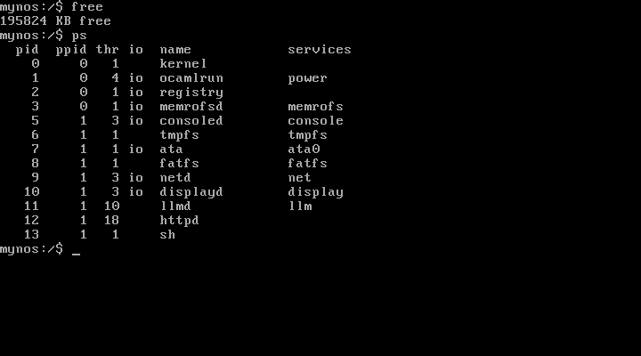

# 11. Watching the System at Work

Most operating systems are watched from outside: a manual says how they
work, and one believes it. MyNOS can be watched from inside, while it
works. This chapter shows the instruments, from the simplest: `ps`, the
list of processes (11.1); `trace`, the event recorder's command (11.2–
11.3); the Recordings and System windows, which draw a recording
(11.4–11.5); the Tour, lessons built on them (11.6); and, last, what
happens when a service dies (11.7). How the recorder works inside the
kernel is told in chapter 22 and appendix G.

## 11.1 Who is running — `ps`

```
mynos:/$ ps
  pid  ppid thr io  name            services
    0     0   1     kernel
    1     0   4 io  ocamlrun        power
    2     0   1 io  registry        registry
    3     0   1 io  memrofsd        memrofs
    5     1   3 io  consoled        console
    6     1   1     tmpfs           tmpfs
    7     1   1 io  ata             ata0
    8     1   1     fatfs           fatfs
    9     1   3 io  netd            net
   10     1   3 io  displayd        display
   11     1  10     llmd            llm
   12     1  18     httpd
   13     1   1     sh
```

| Column | Meaning |
|---|---|
| `pid` | the process's number |
| `ppid` | its parent: 0 is the kernel (the boot modules), 1 is `init` |
| `thr` | its threads (OCaml's domains and threads are threads) |
| `io` | it has the `io` privilege: it may touch the hardware (a driver) |
| `name` | its program; an OCaml program is named after its bytecode |
| `services` | the names it registered in the registry: what others ask it for |



*Figure 11-1. `free` and `ps` at the text console, just after a boot.*

Pid 1 is `init`, which the kernel started as a bare `ocamlrun`, hence
its name; it registered `power`, the service that turns the machine
off. `ps` lists the processes as they are, nothing more: no memory, no
time used. It is a built-in of `sh`, so it is not in its own list.

## 11.2 What happened — `trace`

`trace COMMAND` runs a command and **records everything the system does
meanwhile**: every message between processes, every process born or
ended, every interrupt. Then it prints the calls it found.

**Step 1.** Record a command:

```
mynos:/$ trace -o /tmp/h.trc cat /disk/hello.txt
Hello from a FAT disk!

111 calls
       ms      took  call
    0.737     0.366  trace(23) -> memrofsd(3)  fs/1 Open ("ocamlrun", 0)  =>  Ok 3
   ...
   38.346     0.309  sh(24) -> registry(2)  registry/1 Lookup "fatfs"  =>  Ok 25
   ...
   93.426     0.545  sh(24) -> fatfs(22)  fs/1 Open ("hello.txt", 0)  =>  Ok 11
   98.587     0.266  sh(24) -> fatfs(22)  fs/1 Read (11, 16384)  =>  Ok "Hello from a FAT disk! "
   98.960     0.172  sh(24) -> fatfs(22)  fs/1 Read (11, 16384)  =>  Ok ""
   99.376     0.152  sh(24) -> fatfs(22)  fs/1 Read (11, 16384)  =>  Ok ""
   99.767     0.133  sh(24) -> fatfs(22)  fs/1 Close 11  =>  Ok
recording: /tmp/h.trc (793 events); trace show/calls/json /tmp/h.trc
```

Read a line from the left: when the call started (milliseconds since the
recording began), how long it took, who asked whom, the request in
words, and after `=>` the reply. The first lines are `trace` reading
`ocamlrun` to start `sh`, and the new `sh` reading itself: starting a
program is part of what a command costs. Then `cat`, which is part of
`sh`, opens the file at `fatfs`, reads it, and closes it.

**Step 2.** Make the same recording as the first command after a boot,
when `fatfs` has read nothing yet. A line then appears one step to the
right, under the read:

```
   78.844     1.586  sh(15) -> fatfs(8)  fs/1 Read (4, 16384)  =>  Ok "Hello from a FAT disk! "
   79.108     1.059    fatfs(8) -> ata(7)  block/1 Read (308, 4)  =>  Ok (2048 bytes)
```

This is a **call inside a call**: while serving `sh`, `fatfs` asked the
disk driver for four sectors. In step 1 the file had been read before:
`fatfs` had the sectors in its cache, and `ata` was not asked at all.

**Step 3.** Look at the same recording in other ways:

| Command | What it shows |
|---|---|
| `trace calls FILE` | the calls again, nested, with the marks (11.3) |
| `trace show FILE` | every event, one per line: `=>` a connection, `->` sent, `<-` received, `+` born, `x` ended, `!` an interrupt, `#` a mark |
| `trace json FILE OUT` | a file for Perfetto, the timeline viewer of `ui.perfetto.dev` |

To see the Perfetto file on your computer, write it on `/disk` and
download it through `httpd` (chapter 9):

```
mynos:/$ trace json /tmp/h.trc /disk/h.json
/disk/h.json: open it in ui.perfetto.dev
```

then open `http://localhost:8080/h.json`, save it, and open it in
Perfetto.

**Other uses.** `trace COMMAND` alone saves to `/tmp/last.trace`.
`trace -s SECONDS [-o FILE]` records the whole system for a while,
whatever runs, and prints only the summary line. The options go in that
order: `-s` first, then `-o`. Only one program can record at a time: a
second one says `trace: another program is recording (one recording at
a time)`.

> **THE MyNOS FACTOR — The microkernel made visible: every message, an
> arrow.**
> In a microkernel the parts of the system talk to each other only by
> messages, and every message goes through the kernel. A recorder in the
> kernel therefore sees *all* the interactions of the system, in every
> program, in C or in OCaml, old or new, without changing any of them.
> One `trace` shows the shell, the file system, the disk driver and the
> registry at work together, with the time each took: what other
> systems need a dozen tools for, one recording shows.

## 11.3 Marks

A program can write a **mark** into a recording: a label for a moment
(module `Tracer`, chapter 22). The agent (chapter 12) marks each call to
the model and each tool it uses, so its recording reads as chapters:

```
       ms      took  call
    1.743            # agent(32): model call 1
    2.435    27.465  agent(32) -> llmd(11)  llm/1 Chat ""  =>  Ok
   ...
   30.645            # agent(32): run_command: ls /disk
```

## 11.4 The Recordings window

The menu's **Recordings** shows a recording drawn instead of printed.
It opens `/tmp/agent.trc` if there is one, else `/tmp/last.trace`;
`recordings FILE`, in a terminal window, opens another.

```
 ┌─ Recordings ─────────────────────────────────────────────────────────┐
 │ agent.trc                           751 calls, 3 marks, 17999.2 ms   │
 │[Timeline][Calls][Whole][GUI: hidden][/tmp/agent.trc ][Files][Open][Record]
 │            0 us        5000 ms       10000 ms       15000 ms         │
 │ marks      │model call 1                                        │    │
 │ registry(2)│                                                   ▌│    │
 │ netd(9)    ▌                                                    ▌    │
 │ llmd(11)   ▒▒▒                                                  ▒    │
 │ fatfs(22)  ▌                                                  ▌▌▌    │
 │ sh(51)                                                         ▒     │
 ├──────────────────────────────────────────────────────────────────────┤
 │ the selected call: who, what, the reply, the times, the bytes        │
 └──────────────────────────────────────────────────────────────────────┘
```

**Timeline.** One lane per process. Each call is a light box on its
client's lane (waiting) and a dark box on its server's lane (working).
Marks are orange lines across; click a mark's label to see its step.
The wheel zooms where the pointer is, a drag moves along, **Whole**
shows everything again.

**Calls.** The list that `trace calls` prints, with the marks between.
Click a call to select it.

**The detail**, under either view, describes the selected call: client
and server, the request and the reply in words, when it started, how
long it took, how long it waited for the server and how long the server
worked (and on which thread), and the first bytes of both messages in
hexadecimal.

**The field** at the top takes a file name (**Open**, or **Files** for
the picker) or a command (**Record**: it runs under `trace` and opens
the result). **GUI: hidden** leaves out the display server's traffic,
the frames every window sends; one click shows it.

## 11.5 The System window

The menu's **System** (figure 10-2) draws MyNOS as it is now, in layers:

```
  Programs   sh  gui  welcome  system ...      green: they ask
  Services   init registry memrofsd tmpfs ...  blue: they serve requests
  Drivers    consoled  ata  netd  displayd     orange: they reach the hardware
  Kernel     processes · IPC · memory · timer and scheduler · recorder
  Hardware   CPU  Memory  Timer  Keyboard  Mouse  Serial  Disk  Network  Video
```

Each box is a live process, with its pid, its threads, the names it
registered and what it is written in: **OCaml** (bytecode, run by
`ocamlrun`) or **C**. The window asks the kernel every second: a new
process appears outlined in orange, one that ends fades away. Click a
box, the kernel or a device: the panel at the bottom says what it is.

**Replaying a recording.**

**Step 1.** Type a command in the field (`cat /disk/hello.txt`) and click
**Record**; or a recording's file and **Open**, or **Files**.

**Step 2.** Click **Next**. Each step is drawn on the picture:

| Step | Drawn as |
|---|---|
| a call | a red arrow from the client down into the kernel, along it, and up into the server; the reply in green; "IPC" lit in the kernel |
| an interrupt | a purple arrow from the device up to its driver |
| a process born | a green arrow from its parent, through the kernel, to it |
| a mark | the process that made it, outlined, with the label |

The panel at the bottom says the step in words:

```
sh(55) → registry(2)   registry/1 Lookup "tmpfs"
reply: Ok 19
at 153.70 ms, took 123 us; the server worked 39 us
```

**Step 3.** **Prev** goes back, **Play** runs a step every 0.6 seconds,
**Next mark** jumps to the next mark, and a click on the bar under the
hardware jumps there. **Live** leaves the recording. Processes of the
recording that have ended are grey ghosts. The display's own traffic
and the mouse's interrupts are left out.

## 11.6 The Tour

The menu's **Tour** is a short course on how an operating system works,
with MyNOS as the specimen. Each lesson explains something, then runs a
command under the recorder and opens the System window on what it did,
showing only the processes that matter and saying, at the steps it
explains, what is happening.

**Step 1.** Open the Tour; choose a lesson on the left.

**Step 2.** Read it; click **Run and watch**. A few seconds later a System
window opens with the lesson's text.

**Step 3.** Click **Next note**: the window jumps to the next step the
lesson explains, and explains it. Ticks on the progress bar mark those
steps.

The lessons (in `/tour.txt` on the RAM disk):

| No. | Lesson | It runs | It shows |
|---|---|---|---|
| 1 | A file from the RAM disk | `cat /init.rc` | a program started, then `fs/1` requests to `memrofs`, a C service of 2002 |
| 2 | A directory from the disk | `ls /disk` | `fatfs` asking `ata` for sectors, a call inside a call; the cache, the second time |
| 3 | A program is born | `hello` | the birth of a process, which reads its own program, writes, and ends |
| 4 | Over the network | `ping 10.0.2.2 2` | `sh` asking `netd`, and the card's interrupts coming up from the hardware |
| 5 | Asking a language model | `llm What is a microkernel? Answer in one sentence.` | `llmd` reading its configuration, and going out through `netd` (needs a model, chapter 12) |
| 6 | A service that dies | `kill fatfs; ls /disk` | `init` starting a new `fatfs` after the kernel ended the old one; the new one registering its name again; `sh` finding it by name (11.7) |

**Your own lessons.** Write them in `/disk/tour.txt`; the Tour lists them
after its own. A lesson is a few `key: value` lines, a blank line, and
its text; lessons are separated by a line `---`:

```
title: A file in memory
command: cat /tmp/notes.txt
show: sh, tmpfs, registry
note: Lookup "tmpfs" | sh asks the registry where tmpfs is.
note: fs/1 Read | tmpfs answers from its memory: no disk, no driver.

/tmp is kept by tmpfs, a service in OCaml, in its own memory.
```

`show` names the programs to show; each `note` is `PATTERN | words`. The
words are said at the first step whose description contains the
pattern, as the panel writes it (`sh(15) -> fatfs(8)  fs/1 Open
("hello.txt", 0)`, `IRQ 9 -> netd(9)`, `spawn of hello(16), by sh(15)`,
`exit of sh(15): exit, status 0`). Copy patterns from what the panel
shows.

> **THE MyNOS FACTOR — An operating system that explains itself while it
> runs.**
> The Tour does not show pictures of how MyNOS might work. It runs a
> real command on the real system, records what the processes said to
> each other, and replays it. If a lesson's notes stopped matching what
> the system does, its words would not appear: the course is checked
> against the system each time it is taught.

## 11.7 A service that dies

`init`, the first program, starts the services listed in `/init.rc`, and
watches them:

```
driver consoled          the console
start tmpfs.byte         /tmp
driver ata.byte          the disk driver
start fatfs.byte         /disk
driver netd              the network
driver displayd          the display
start llmd.byte          the language models
start httpd.byte         the web server
respawn sh.byte          the shell at the console
```

A `start` or `driver` service that **crashes or is killed** is started
again, after a third of a second, at most five times a minute. One that
ends by itself with status 0 has decided to stop, and is left alone. A
`respawn` program, the console's `sh`, is started again whenever it
ends: `exit` at the console gives you a new shell.

**Try it.** Kill the disk's file system, and use the disk:

```
mynos:/$ kill fatfs
mynos:/$ cat /disk/hello.txt
Hello from a FAT disk!
mynos:/$ ps
  ...
   22     1   1     fatfs           fatfs
```

`kill` takes a pid or a service's name. `fatfs` ended, `init` started a
new one (here pid 22, instead of 8), the new one registered the name
`fatfs` again, and the next request from `sh` found it by name. The
kernel log tells it:

```
process 8 (fatfs) killed by 13
init: fatfs.byte (pid 8) ended: signal 9
init: restarting fatfs.byte
init: started fatfs.byte (pid 22)
fatfs: FAT16, 8167 clusters of 2048 bytes, service fs/1 as fatfs
```

Drivers and `init` cannot be killed (`sh: kill: 7: not allowed (init, or
a driver)`). In the System window, the old `fatfs` fades and the new one
appears outlined. The Tour's sixth lesson, *A service that dies*, runs this
and explains each step as it replays (11.6).

> **THE MyNOS FACTOR — A service that dies is just a process that ends:
> it comes back.**
> In a monolithic kernel the file system is part of the kernel: if it
> fails, the machine stops. In MyNOS it is a program like `sh`. It can
> be killed, and the kernel frees what it held; `init` starts it again;
> its clients look its name up again in the registry and carry on.
> What was in its memory is lost (`/tmp`, if `tmpfs` dies), but the
> system is not.
