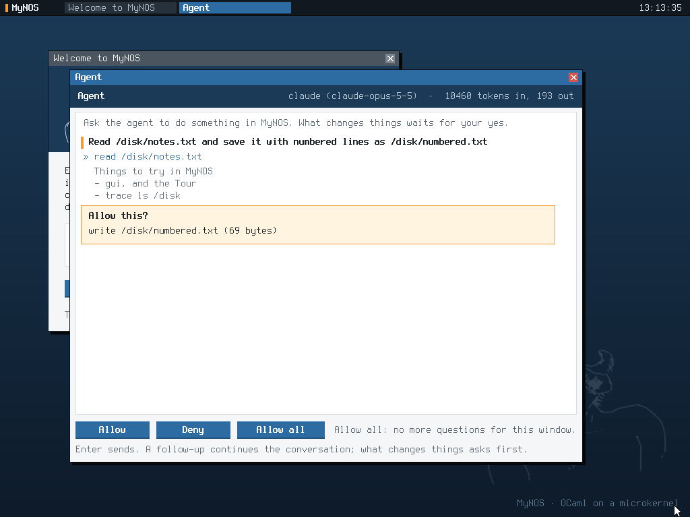
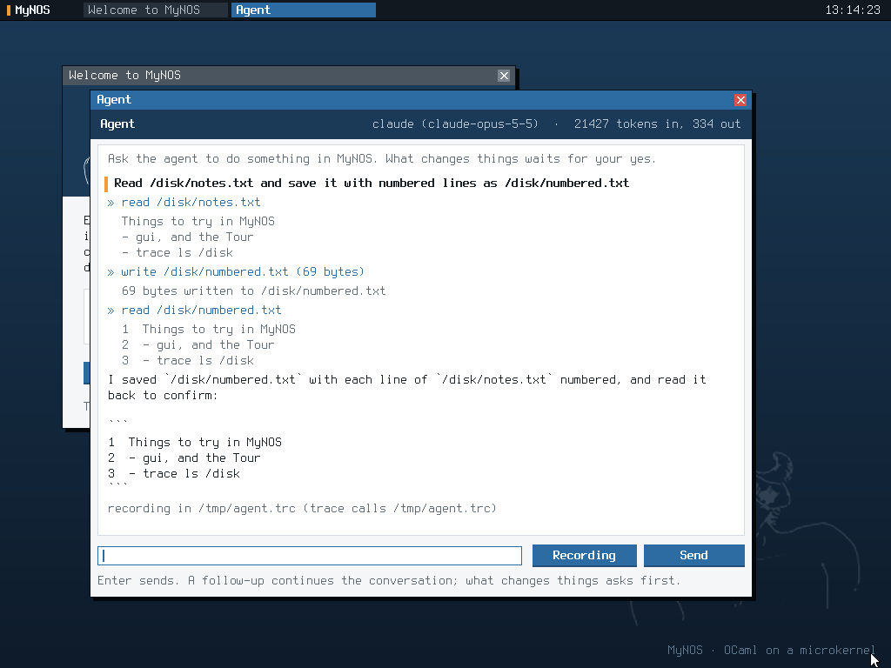

# 12. Language Models and Agents

MyNOS can ask a language model: a question (`llm`), a command for the
shell (`ask`), or a whole task, carried out step by step with the
system's own tools (`agent`, and the Agent window). The models are not
in MyNOS: they are services on the Internet (Claude, OpenAI) or programs
on your computer (Ollama, vLLM), reached through the network. In MyNOS
they are one more service, `llmd`, which programs ask over typed IPC
like any other. This chapter shows how to configure it (12.1–12.2), the
three commands (12.3–12.5), what the agent may do and how it asks you
first (12.6–12.8), and how to see what it did (12.9). How it is built is
told in chapter 21.

Everything here is **optional**. Without a configuration MyNOS works the
same; `llm`, `ask` and the agent say that no model is configured.

## 12.1 What you need

- A network (chapter 9): MyNOS reaches the model through `netd`.
- An account with a provider and its API key, or a model server on your
  computer that speaks OpenAI's Chat Completions (Ollama, vLLM,
  llama.cpp, LM Studio...).
- A file `/disk/llm.env` describing the models: the **profiles**.

## 12.2 Step 1: the configuration file

`llmd` reads `/disk/llm.env`, a `.env` file like those of many
programs: one `NAME=value` per line. It reads it again **at every
request**, so an edit takes effect at once, with no restart.

The easiest way to make it is on your computer. In MyNOS's sources,
copy `llm.env.example` to `llm.env`, put your keys in it, and start
MyNOS with `tools/run-demo.sh`, which copies it into the disk image:

```
run-demo.sh: llm.env copied to /disk/llm.env
```

(`llm.env` is ignored by git: your keys stay out of the repository.)
You can also write the file inside MyNOS with `edit /disk/llm.env`, or
bring it in with `fetch -o` (chapter 9).

**Profiles.** Each model you want to use is a profile, a group of lines
`LLM_<NAME>_...`. Programs choose a profile by its name in lower case
(`llm -p local ...`), or get the default one.

| Line | Meaning |
|---|---|
| `LLM_DEFAULT=name` | the profile used when none is chosen; without it, the first one in the file |
| `LLM_<NAME>_API` | `anthropic` (Claude's Messages API) or `openai` (Chat Completions) |
| `LLM_<NAME>_MODEL` | the model's name for that API |
| `LLM_<NAME>_KEY` | the API key; empty for servers that need none |
| `LLM_<NAME>_URL` | the API's address, ending in `/v1`; by default Anthropic's or OpenAI's |
| `LLM_<NAME>_MAX_TOKENS` | the longest answer, in tokens (16000 by default) |
| `LLM_<NAME>_EFFORT` | `anthropic` only: `low`, `medium`, `high`, `xhigh` or `max`, how much the model thinks |
| `LLM_<NAME>_FALLBACKS` | `anthropic` only: `default` lets the API answer with another model when this one declines |

`API` and `MODEL` are required; a profile without them makes every
request fail with a message naming the line that is wrong.

The syntax is a `.env` file's: `#` starts a comment; `export ` before a
line is allowed; a value may be in double quotes, in single quotes, or
bare (a ` #` then ends it); `${NAME}`, in a bare or double-quoted value,
is replaced by a value set earlier in the file, so that one key can
serve several profiles.

A file with two profiles, Claude by default and a model on your
computer (the key is a placeholder: never write a real key in a
document, or in a file others can read):

```
LLM_DEFAULT=claude

ANTHROPIC_API_KEY=sk-ant-...
LLM_CLAUDE_API=anthropic
LLM_CLAUDE_MODEL=claude-opus-5-5
LLM_CLAUDE_KEY=${ANTHROPIC_API_KEY}
LLM_CLAUDE_EFFORT=medium

# Ollama on your computer (10.0.2.2, seen from MyNOS)
LLM_LOCAL_API=openai
LLM_LOCAL_MODEL=qwen3:8b
LLM_LOCAL_URL=http://10.0.2.2:11434/v1
```

**Your keys.** MyNOS has no users yet: any program in it can read
`/disk/llm.env` (`httpd` does not serve it, chapter 9). To keep a key out of MyNOS altogether, run on your
computer a proxy that adds it, point `URL` at it
(`http://10.0.2.2:PORT/v1`) and leave `KEY` empty.

## 12.3 Step 2: a question — `llm`

```
llm [-p PROFILE] [-s SYSTEM] [-v] QUESTION...
llm -l
```

**List the profiles** first, to check the file:

```
mynos:/$ llm -l
claude (default)	anthropic	claude-opus-5-5
local	openai	qwen3:8b
```

**Ask.** The words after the options are the question; quotes are not
needed. The answer is printed as it comes back, whole (it is not shown
while it is being written):

```
mynos:/$ llm Which year was OCaml born?
```

| Option | What it does |
|---|---|
| `-p PROFILE` | use another profile |
| `-s SYSTEM` | a system prompt: instructions for the model. One word: quote it (`-s 'Be brief.'`) |
| `-v` | also print the model's name and the tokens used (`llm: MODEL, N tokens in, M out`) |
| `-l` | list the profiles: name, API, model |

Without a question, `llm` reads it from its input: `llm < question.txt`.
If the answer was cut at the profile's `MAX_TOKENS`, or the model
declined, `llm` says so after it.

Errors say what went wrong: `llm: no model configured: write
/disk/llm.env (see llm.env.example in MyNOS's sources)`; `llm: no
profile "gpt" (there are: claude, local)`; the provider's own message
for a bad key; `llm: no llm service (llmd)` if the service is not
running.

## 12.4 Step 3: a command for the shell — `ask`

`ask` is built into `sh`. Write what you want in your own words; the
model proposes **one command line**, with a sentence explaining it, and
`sh` runs it only if you say yes:

```
mynos:/$ ask list the files in /disk with their sizes
Lists the files in /disk with their sizes.
  ls -l /disk
Run it? [y/N]
```

Press `y` to run it; any other key (Enter included) does not, and the
status is then 1. The model is told how `sh` works (its syntax, and what
it lacks: no loops, no arithmetic), every command available, the current
directory and its files. A question that needs no command gets a short
answer in words instead. `ask -p PROFILE ...` chooses the profile.

Nothing runs without your yes, in a script either. When `sh`'s input is
a file, the answer is read as a line from it.

## 12.5 Step 4: a task — `agent`

```
agent [-p PROFILE] [-s SERVICE,...] [-y] [-n TURNS] [-t FILE] TASK...
```

`agent TASK` gives the task to the model **with tools**: it can look at
files, run commands, write and compile OCaml programs, and call MyNOS's
services. The model decides what to do; the agent does it, sends back
the result, and asks the model again, until the model answers without
asking for a tool.

```
mynos:/$ agent Write the IP address of MyNOS in /disk/ip.txt
agent: Write the IP address of MyNOS in /disk/ip.txt
  net_config {}
  -> {"mac":"52:54:00:12:34:56","address":"10.0.2.15",...
  write /disk/ip.txt (10 bytes)
  Do it? [y/N/a] y
  -> 10 bytes written to /disk/ip.txt
I wrote 10.0.2.15 in /disk/ip.txt.
agent: recording in /tmp/agent.trc (trace calls /tmp/agent.trc)
agent: 4211 tokens in, 187 out
```

(An illustration: what a model chooses to do varies.) Each line has a
meaning: `agent:` lines are the agent's own; indented lines are what a
tool does, and `->` its result (the first line, cut at 100 characters);
unindented lines are the model's words.

| Option | What it does |
|---|---|
| `-p PROFILE` | another profile |
| `-s SERVICE,...` | the typed services whose requests it may use (`net` by default; 12.7) |
| `-y` | no confirmations: everything is allowed. Careful |
| `-n TURNS` | at most so many calls to the model (20 by default) |
| `-t FILE` | where to save the recording (`/tmp/agent.trc` by default; 12.9) |

## 12.6 Confirmations

What only reads (a file, a directory, a module's signature, a request
marked safe) the agent does at once, and shows. What **changes things**
it shows first, and waits:

```
  run: ls /disk
  Do it? [y/N/a]
```

| Key | Answer |
|---|---|
| `y` | yes, this once |
| `n`, Enter, anything else | no: the model is told you refused, and goes on without it |
| `a` | yes, and to everything else in this task |

What is confirmed: a command line (`run:`), a file written (`write PATH
(N bytes)`), an OCaml program run or built, and a service's request not
marked safe (`net_connect ...`). `-y` answers yes to all of them. The
agent runs with no privilege: it can do what your own commands can, no
more.



*Figure 12-1. The agent asks before it writes a file.*

## 12.7 What the agent can use

**Its own tools:**

| Tool | What it does | Asks first |
|---|---|---|
| `run_command` | one line of `sh`, in a new shell; its output and exit status come back | yes |
| `read_file` | a file's contents | no |
| `write_file` | writes (or replaces) a file | yes |
| `list_directory` | a directory's entries, with sizes | no |
| `ocaml_signature` | a module's interface, as the toplevel shows it (`Net`, `Gui`, `List`...) | no |
| `run_ocaml` | compiles an OCaml program against MyNOS's libraries (with `Unix`, `Thread`, `Str`, `Num`, `Graphics` when it names them, as `compile` does: 8.8); if it type-checks, runs it | yes, before running |
| `build_ocaml` | compiles a program into a `.byte` file, without running it (a window, a service) | yes |

Each `run_command` starts a new `sh`: a `cd` does not carry over to the
next one. A program that keeps running (a window, a service) is built
with `build_ocaml` and started with `run_command "PROGRAM &"`.

**The packages' tools.** An installed package can add a tool of its own
(chapter 9, 9.8): `wiki` gives `wikipedia`, the beginning of an article;
`calc` gives `calculate`, exact arithmetic. Both change nothing, so the
agent uses them without asking.

**The services' requests.** With `-s`, every request of the services
named becomes a tool, called `SERVICE_REQUEST` (`net_resolve`,
`llm_chat`...), built from the service's own description of its protocol
(chapter 17). The typed services, by their registered names:

| Name | What it is | Its requests |
|---|---|---|
| `net` | the network (default) | `config`, `ping`, `resolve` (safe); `connect`, `listen`, `send`, `connect_tls`, UDP... |
| `llm` | the language models | `profiles` (safe), `chat` |
| `fatfs`, `tmpfs`, `memrofs` | the file services of `/disk`, `/tmp`, `/` | `read`, `list`, `seek`, `close` (safe); `open`, `write`, `remove`, `mkdir`... |
| `ata0` | the disk driver | `info`, `read` (safe); `write` |
| `display` | the display server | `info` (safe); windows |
| `registry` | the names | `list`... |
| `console` | the console | modes, writing |
| `power` | `init`'s power service | `shutdown`, `reboot` |
| `clipboard`, `sound`, `pager` | the clipboard, sound, the external pager | ... |

For example, `agent -s net,registry 'Which services are running?'` lets
the model call `registry_list`. Give only what the task needs: a
request that is not marked safe still asks you first, but `-s power`
lets the model propose to turn the machine off.

> **THE MyNOS FACTOR — The type checker as a contract between the model
> and the system.**
> When the agent writes a program, it does not run what the model wrote
> and hope. `run_ocaml` first compiles it inside MyNOS, against the
> real interfaces of MyNOS's libraries. If the model got a type wrong,
> the compiler's message goes back to it, and nothing runs:
>
> ```
>   compile (1 lines of OCaml)
>   -> error: It does not compile: ...
> File "/tmp/.agent-35-1.ml", line 1, characters 23-25:
> 1 | let () = print_endline 42
>                            ^^
> Error: The constant 42 has type int but an expression was expected of type
>          string
> ```
>
> Only a program that type-checks is shown to you and, if you agree,
> run. The interfaces the model must respect are the same ones the
> system's own programs are compiled against; `ocaml_signature` lets the
> model read them before it writes.

## 12.8 Step 5: the Agent window

In the graphical session (chapter 10), the MyNOS menu's **Agent**, or the
welcome window's button, opens the same agent in a window.

**Step 1.** The header shows the model (the default profile) and the
tokens used so far. Type the task in the field at the bottom; Enter, or
**Send**, starts it.

**Step 2.** The conversation scrolls above: your task, with an orange
bar; the model's words; each action, after `»`; the first six lines of
each result, red for an error.

**Step 3.** When the agent wants to change something, a box appears in
the conversation, **Allow this?**, with the action, and three buttons
take the place of the field:

```
 ┌───────────────────────────────────────────┐
 │ Allow this?                               │
 │ run: ls /disk                             │
 └───────────────────────────────────────────┘
 [ Allow ]  [ Deny ]  [ Allow all ]   Allow all: no more questions for this window.
```

**Allow all** holds for the rest of the window's life.

**Step 4.** When the task is done, type a **follow-up**: it continues the
same conversation ("and now put it in a file"). **Recording** opens the
last task's recording in the Recordings window (12.9). The window uses
the default profile and the `net` service only.



*Figure 12-2. A task done in the Agent window: each tool call, its result, and the agent's answer.*

## 12.9 What the agent did

The agent records the whole system while it works, with the event
recorder (chapter 11), and saves the recording in `/tmp/agent.trc`. It
marks each call to the model and each tool, so the recording reads as
the story of the task:

```
mynos:/$ trace calls /tmp/agent.trc
189 calls
       ms      took  call
    1.743            # agent(32): model call 1
    2.435    27.465  agent(32) -> llmd(11)  llm/1 Chat ""  =>  Ok
    3.260     0.679    llmd(11) -> fatfs(22)  fs/1 Open ("llm.env", 0)  =>  Ok 31
   ...
   19.412     0.104    llmd(11) -> registry(2)  registry/1 Lookup "net"  =>  Ok 22
   20.024     3.069    llmd(11) -> netd(9)  net/1 Connect ("10.0.2.2", 47592)  =>  Ok 1
   23.876     0.597    llmd(11) -> netd(9)  net/1 Send (1, (12390 bytes))  =>  Ok 12390
   24.823     3.524    llmd(11) -> netd(9)  net/1 Recv (1, 16384)  =>  Ok (416 bytes)
   ...
   30.645            # agent(32): run_command: ls /disk
   32.836  8375.962  agent(32) -> consoled(5)  console/1 Read 65536  =>  Ok "y"
   ...
```

(This recording was made with a test provider on the host, at port
47592; with Claude, the connection is `net/1 Connect_tls` to
`api.anthropic.com`.) Read it from the top: the agent asks `llmd`;
`llmd` reads its configuration and goes out through `netd`; then the
tool, and, here, the eight seconds the agent waited for your `y`. The
Recordings and System windows show the same file as a timeline and on
the system's picture.

If another program is recording when a task starts, the agent works
without recording and says `not recorded: another program is
recording`.
