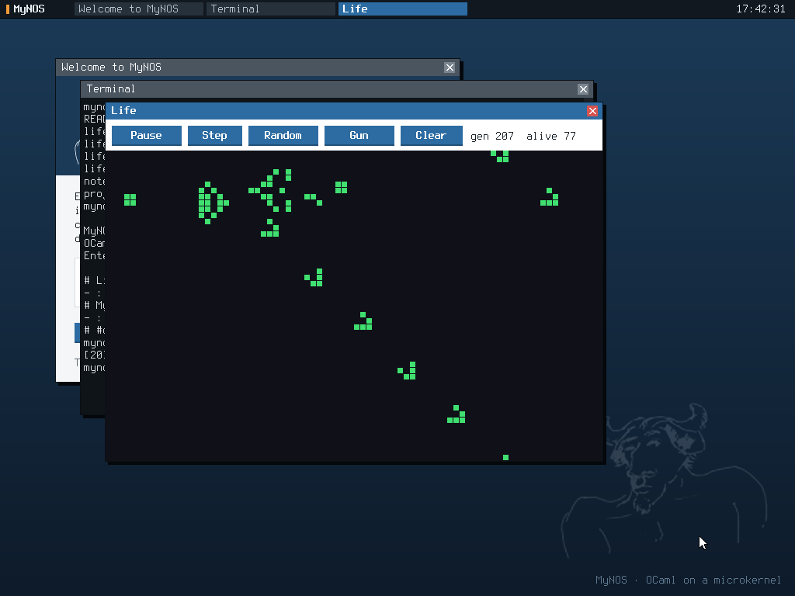

# 20. Graphics

A graphical program in MyNOS is an ordinary process that asks the display
service for a window, draws into the window's pixels in its own memory,
and waits for events. This chapter explains the three modules it uses:
`Display`, the windows and their events (20.2); `Gfx`, drawing on pixels
(20.3); and `Gui`, a small immediate-mode toolkit (20.4). It ends with a
complete program, Conway's Game of Life in a window (20.5), and with
OCaml's own `Graphics` library, which MyNOS also has (20.6). The display
server itself is described in appendix E.14, the drawing primitives in
appendix F.5, and the reasons for the design in `doc/decisions/gui.md`.

## 20.1 The picture

```
   your program (OCaml)                     displayd (C, io privilege)
  ┌──────────────────────────────┐          ┌──────────────────────────────┐
  │ Gui      run, button, label  │          │ composes the windows, their  │
  │ Display  window, damage,     │ display/1│ title bars, the pointer and  │
  │          next_event ─────────┼─────────►│ the desktop; the PS/2 mouse; │
  │ Gfx      fill, text (C)      │◄─────────┼ keys from consoled           │
  │                              │  events  │                              │
  │  ┌──────────────────────┐    │  shared  │  ┌──────────────────────┐    │
  │  │ the window's pixels  │◄═══╪══════════╪═►│ the same pages       │    │
  │  └──────────────────────┘    │  pages   │  └──────────┬───────────┘    │
  └──────────────────────────────┘          │             ▼                │
                                            │   the frame buffer (BGA)     │
                                            └──────────────────────────────┘
```

The pixels of a window are a buffer of the program, shared with `displayd`
when the window is made: no drawing commands travel. The program draws,
then sends a `damage` request naming the rectangle that changed, and
`displayd` copies it to the screen. Events (keys, the mouse, the close
box, timer ticks) come back as replies to `next_event`.

A window can be made only while the **graphical session** is on: the
`gui` command starts it, and programs then run from a Terminal window,
from the Files window, or with `&`. Outside it, `displayd` refuses
("no graphical session: start it with gui").

## 20.2 Windows and events: module `Display`

```ocaml
val window : ?display:t -> ?title:string -> int -> int -> window
val damage : ?x:int -> ?y:int -> ?w:int -> ?h:int -> window -> unit
val next_event : ?timeout:float -> window -> event
val poll : window -> event
val set_title : window -> string -> unit
val move : window -> int -> int -> unit
val destroy : window -> unit
```

`Display.window ~title w h` makes a window whose content is `w` by `h`
pixels (the title bar is extra) and returns `{ display; id; pixels }`,
where `pixels` is a `Gfx.t`, white until drawn. `damage w` shows all of
it again; `damage ~x ~y ~w ~h w`, a part. The screen is 1024 by 768.

`next_event` waits for the window's next event:

| Event | When |
|---|---|
| `Key s` | a key, to the window that has the focus: UTF-8 text, or a VT100 sequence (`"\027[A"` for ↑), `"\r"` for Enter, `"\127"` for Backspace |
| `Mouse { x; y; buttons }` | the pointer moved or a button changed, in window coordinates; `buttons`: 1 left, 2 right, 4 middle |
| `Key_up s` | the key whose `Key s` came was let go (several may be held at once) |
| `Resize (w, h)` | the user asked for this size (a resizable window): answer with `Display.resize` |
| `Wheel n` | the wheel over the window: `n` notches, positive downwards |
| `Focus b` | the window got (`true`) or lost the focus |
| `Close` | its close box was clicked, or the session ended |
| `Tick` | nothing came within `timeout` seconds |

`timeout` is 0 by default: wait forever. `displayd` checks the timeouts
every 100 ms, so a `Tick` comes between `timeout` and `timeout + 0.1`
seconds after the call; and only if no other event came first. `poll w`
does not wait: the next event if one is queued, `Tick` at once if none.
It is meant for a program that animates and reads the keys between
frames.

The example of `Display`'s interface, made whole: a blue window that
draws a yellow dot where the left button is pressed, and ends on `q` or
its close box.

```ocaml
let () =
  let w = Display.window ~title:"Hello" 300 120 in
  Gfx.fill w.Display.pixels 0 0 300 120 0x2D6CA2;
  ignore (Gfx.text w.pixels 20 50 "Hello, MyNOS" 0xFFFFFF);
  Display.damage w;
  let rec loop () =
    match Display.next_event w with
    | Display.Close -> Display.destroy w
    | Display.Key "q" -> Display.destroy w
    | Display.Mouse { x; y; buttons = 1 } ->
      Gfx.fill w.pixels (x - 2) (y - 2) 5 5 0xFFD000;
      Display.damage ~x:(x - 2) ~y:(y - 2) ~w:5 ~h:5 w;
      loop ()
    | _ -> loop () in
  loop ()
```

A window belongs to the process that made it; a timer in `displayd`
removes the windows of programs that ended, so a program that crashes
leaves nothing behind. `destroy` removes it at once.

## 20.3 Drawing: module `Gfx`

A `Gfx.t` is a buffer of 32-bit pixels, `{ pixels; width; height }`;
`Gfx.create w h` makes one (white, page-aligned so that it can be
shared), and every window has one. Colours are integers `0xRRGGBB`;
`Gfx.rgb r g b` builds one, `Gfx.mix a b t` blends two (`t` from 0. to
1.).

| Function | Draws |
|---|---|
| `fill g x y w h c` | a filled rectangle |
| `rect g x y w h c` | its outline |
| `line g x0 y0 x1 y1 c` | a line |
| `text ?bold ?max g x y s c` | UTF-8 text, top left at `(x, y)`; returns the cells written |
| `blit src sx sy dst dx dy w h` | a copy of a rectangle; `src` and `dst` may be the same buffer |
| `draw_mask ?opacity g x y m c` | a grey image as ink of colour `c` |
| `get g x y` | (reads) a pixel's colour, -1 outside |

Everything is clipped to the buffer: drawing partly outside is allowed.
The primitives are C (`mynos-runtime/gfx_stubs.c`), because a loop over
pixels in bytecode is too slow; a program that calls `fill` a thousand
times a frame, as Life does below, is still fast enough.

**Text** is drawn in the Terminus font, 8 by 16 pixels a character
(`Gfx.char_w`, `Gfx.char_h`), regular or bold. One character is one
cell; `Gfx.cells s` counts the characters of a UTF-8 string, so the
width of a text in pixels is `Gfx.cells s * Gfx.char_w`. `~max` cuts it
to that many cells. The font files are on the RAM disk
(`/terminus16.psf`, `/terminus16-bold.psf`).

**Clipping.** `Gfx.with_clip x y w h f` runs `f ()` with every primitive
drawing only inside the rectangle; clips nest, each inside the one
around it. `Gfx.clip ()` tells the clip in force. The clip belongs to
the process, not to a buffer: draw from one domain at a time.

**Masks** are grey images used as ink: `Gfx.load_mask "/mynos-logo.pgm"`
reads a binary PGM file, and `draw_mask g x y m c` paints colour `c` where
the image is dark, leaving white parts alone. The MyNOS logo on the
desktop is drawn this way, on any background.

## 20.4 A toolkit: module `Gui`

`Gui` (`mynos-lib/ocaml/gui.mli`, 350 lines of OCaml) is **immediate
mode**: there are no widget objects. The program keeps its own state, and
gives `Gui.run` a function that draws a whole frame from that state and
returns the next state. A widget is a function call that draws itself
and tells, in the same call, what happened to it:

```ocaml
let () =
  Gui.run ~title:"Counter" 200 90 0 (fun ui n ->
      Gui.label ui 16 16 (Printf.sprintf "Clicked %d times" n);
      if Gui.button ui 16 44 120 "Click me" then n + 1 else n)
```

`Gui.run ?title ?tick w h state frame` makes the window, then loops: it
clears the pixels to `Gui.background`, calls `frame ui state`, shows the
result (`damage`), and waits for the next event, which it records in `ui`
before the next frame. It ends when the window is closed, or when
`frame` raises `Gui.Quit`. With `~tick:s` a frame also comes every `s`
seconds without events, with `ui.tick` set: animations and clocks use
it. With `~resizable:(min_w, min_h)` the user may resize the window (its
grip, a double click on its title): `run` takes the new pixels itself,
and `frame` lays out by `Gui.width ui` and `Gui.height ui`. Outside the
graphical session `run` prints why and ends the program with exit
status 2.

The `ui` record is what the frame knows about input:

| Field | Meaning |
|---|---|
| `g` | the window's pixels, to draw with `Gfx`; new ones after a resize (`Gui.width ui`, `Gui.height ui`: its size now) |
| `mx`, `my`, `buttons` | the pointer, in the window, and its buttons |
| `clicked`, `press` | the left button was released in this frame; where it was pressed |
| `keys` | the keys of this frame (one per event) |
| `released`, `held` | the keys let go in this frame; those held down now (games) |
| `wheel` | the wheel's notches in this frame |
| `tick` | this frame is the timer's |
| `focused` | the window has the focus |

The widgets, each drawn at the given position (pixels, from the window's
top left):

| Widget | Returns |
|---|---|
| `label ?colour ?bold ui x y s` | `unit` |
| `paragraph ?colour ui x y width s` | the height used: `s` wrapped at words |
| `panel ?colour ui x y w h` | `unit`: a white box with a border |
| `button ?h ui x y w s` | `true` in the frame it is clicked (pressed and released on it) |
| `text_field ui id x y w value` | the value, edited by this frame's keys if the field has them, at its cursor (a click places it; Left, Right, Home, End, Backspace, Delete) |
| `list_item ui x y w ~selected s` | `true` when clicked |
| `scroll ?colour ui id x y w h content` | `unit`: a box whose `content top` draws, clipped, and returns its height |
| `file_picker ui id` | `Some (Picked path)` or `Some Cancelled` once answered (open it with `open_file_picker`) |

Widgets that remember something between frames take an `id`, a number
that tells them apart in a window: which text field has the keys (the
last one clicked), how far a scroll box is scrolled. A text field takes
printable keys and Backspace; the program sees Enter itself, in
`ui.keys` (`"\r"`). A scroll box learns its content's height only by
drawing it, and uses it at the next frame; `scroll_to_end ui id` keeps a
log or a conversation at its end. `Gui.hovered ui x y w h` tells
whether the pointer is over a rectangle, for widgets of one's own.

A multi-line text box is module `Textarea` (the text editor, `text`, is
made of one): `Textarea.create ?highlight s`, then `Textarea.frame ui
id t x y w h` in each frame draws it and gives it the keys and the mouse
(selection, undo, copy and paste, colours: `Textarea.ocaml`); `text`,
`replace_lines`, `find`, `goto` and marks under ranges (errors) are for
the program.

A window with a field, a list and a scroll box. It opens with the
counter at 0, an empty field, `red` selected in the list on the left and
an empty box on the right; each click on the button adds a line to the
box, with the name typed in the field:

```ocaml
type state = { n : int; name : string; picked : int; log : string list }

let colours = [ "red"; "green"; "blue"; "cyan"; "magenta"; "yellow" ]

let () =
  Gui.run ~title:"Widgets" 360 300 { n = 0; name = ""; picked = 0; log = [] }
    (fun ui st ->
       Gui.label ui 16 16 (Printf.sprintf "Clicked %d times" st.n);
       let clicked = Gui.button ui 16 40 120 "Click me" in
       Gui.label ui 16 82 "Name:";
       let name = Gui.text_field ui 1 64 78 200 st.name in
       let picked = ref st.picked in
       List.iteri (fun i c ->
           if Gui.list_item ui 16 (112 + 20 * i) 120 ~selected:(i = st.picked) c
           then picked := i) colours;
       Gui.scroll ui 2 160 112 184 120 (fun y0 ->
           List.iteri (fun i l -> Gui.label ~colour:Gui.muted ui 166 (y0 + 4 + 18 * i) l)
             st.log;
           8 + 18 * List.length st.log);
       let log =
         if clicked then Printf.sprintf "click %d (%s)" (st.n + 1) name :: st.log
         else st.log in
       { n = (if clicked then st.n + 1 else st.n); name; picked = !picked; log })
```

The state here is immutable and each frame returns a new one; Life,
below, mutates its state and returns it. Both are fine: `run` only
passes along what the frame returns.

> **THE MyNOS FACTOR — Pixels in C, everything else in OCaml.**
> The whole graphical interface of MyNOS (the desktop's windows, the
> terminal with its VT100 emulator, the file manager, the recordings'
> timeline, the System window) is OCaml bytecode on fifteen drawing
> primitives in C. A window is a page-aligned buffer shared with the
> display server, so the toolkit draws into the screen's own memory at
> the speed of C, while its logic is typed, garbage-collected code that
> a program, or a language model writing one, can read and change.

## 20.5 A complete example: Life in a window

The program below is Conway's Game of Life on an 80 by 50 board that
wraps around at the edges, with buttons to pause, step, randomize, load
Gosper's glider gun and clear, the same commands on keys, and clicks on
the board to turn cells on and off. It began as `/disk/life.ml` on a
development disk, written inside MyNOS on 2026-11-18, the day the
agent's `build_ocaml` tool was added (the tool's description still names
`/disk/life.byte` as its example); here its labels are translated into
English and its comments completed.

```ocaml
(* Life: Conway's Game of Life in a window. *)

let cols = 80 and rows = 50          (* the board, in cells *)
let cell = 8                         (* a cell, in pixels *)
let top = 40                         (* the bar of buttons *)
let w = cols * cell
let h = top + rows * cell

type state = {
  mutable grid : bool array;         (* cols * rows, row by row *)
  mutable running : bool;
  mutable gen : int;
}

(* the board is a torus: the edges wrap around *)
let idx x y = ((y + rows) mod rows) * cols + ((x + cols) mod cols)

let step g =
  Array.init (cols * rows) (fun i ->
      let x = i mod cols and y = i / cols in
      let n = ref 0 in
      for dy = -1 to 1 do
        for dx = -1 to 1 do
          if (dx <> 0 || dy <> 0) && g.(idx (x + dx) (y + dy)) then incr n
        done
      done;
      if g.(i) then !n = 2 || !n = 3 else !n = 3)

let random_grid () = Array.init (cols * rows) (fun _ -> Random.int 100 < 25)
let empty () = Array.make (cols * rows) false

(* Gosper's glider gun *)
let glider_gun () =
  let g = empty () in
  List.iter (fun (x, y) -> g.(idx (x + 2) (y + 2)) <- true)
    [ (1,5); (1,6); (2,5); (2,6); (11,5); (11,6); (11,7); (12,4); (12,8);
      (13,3); (13,9); (14,3); (14,9); (15,6); (16,4); (16,8); (17,5);
      (17,6); (17,7); (18,6); (21,3); (21,4); (21,5); (22,3); (22,4);
      (22,5); (23,2); (23,6); (25,1); (25,2); (25,6); (25,7); (35,3);
      (35,4); (36,3); (36,4) ];
  g

let frame ui st =
  let g = ui.Gui.g in
  (* the board's background, and the bar *)
  Gfx.fill g 0 0 w h 0x101018;
  Gfx.fill g 0 0 w top Gui.panel_colour;
  (* the buttons: drawn, and answered, in the same call *)
  if Gui.button ui 8 8 90 (if st.running then "Pause" else "Run") then
    st.running <- not st.running;
  if Gui.button ui 106 8 70 "Step" then begin
    st.grid <- step st.grid; st.gen <- st.gen + 1 end;
  if Gui.button ui 184 8 90 "Random" then begin
    st.grid <- random_grid (); st.gen <- 0 end;
  if Gui.button ui 282 8 90 "Gun" then begin
    st.grid <- glider_gun (); st.gen <- 0 end;
  if Gui.button ui 380 8 80 "Clear" then begin
    st.grid <- empty (); st.gen <- 0; st.running <- false end;
  (* the keys typed since the last frame *)
  List.iter (function
      | " " -> st.running <- not st.running
      | "s" -> st.grid <- step st.grid; st.gen <- st.gen + 1
      | "r" -> st.grid <- random_grid (); st.gen <- 0
      | "c" -> st.grid <- empty (); st.gen <- 0
      | "q" -> raise Gui.Quit
      | _ -> ()) ui.Gui.keys;
  (* a click on the board turns a cell on or off *)
  if ui.Gui.clicked && ui.Gui.my >= top && ui.Gui.my < h
     && ui.Gui.mx >= 0 && ui.Gui.mx < w then begin
    let i = idx (ui.Gui.mx / cell) ((ui.Gui.my - top) / cell) in
    st.grid.(i) <- not st.grid.(i)
  end;
  (* the timer: one generation *)
  if ui.Gui.tick && st.running then begin
    st.grid <- step st.grid; st.gen <- st.gen + 1 end;
  (* the cells *)
  let alive = ref 0 in
  Array.iteri (fun i a ->
      if a then begin
        incr alive;
        let x = i mod cols and y = i / cols in
        Gfx.fill g (x * cell) (top + y * cell) (cell - 1) (cell - 1) 0x40E070
      end) st.grid;
  ignore (Gfx.text g 470 14
            (Printf.sprintf "gen %d  alive %d" st.gen !alive) Gui.foreground);
  st

let () =
  Random.self_init ();
  Gui.run ~title:"Life" ~tick:0.1 w h
    { grid = random_grid (); running = true; gen = 0 } frame
```

**The state** is the board, a flat array of `cols * rows` booleans, and
two counters. `idx` turns a cell's coordinates into an index, wrapping
around both edges, so `step` needs no special case at the borders:
every cell has eight neighbours. `step` builds the next board from the
old one (a cell lives with 2 or 3 live neighbours, is born with exactly
3); the old array is left to the garbage collector.

**The frame** does everything, every time. It paints the background and
the bar, then the five buttons: each `Gui.button` draws itself and
returns `true` if this frame's event was a click on it, so the reaction
sits next to the drawing. The keys come next, from `ui.keys`; `q`
raises `Gui.Quit`, which ends `run` and destroys the window. A click
below the bar is a click on the board: the pointer's position divided by
the cell size is the cell. Last comes time: a frame caused by the timer
(`ui.tick`) advances one generation if the game runs. Then the live cells
are drawn, 7 by 7 pixels in cells of 8, so the dark background shows
through as a grid, and the counters are written in the bar.

**Time.** `~tick:0.1` asks `run` for a frame when no event has come for
0.1 seconds. Each event (a pointer move over the window, a key) also
makes a frame, without `ui.tick`, so the board advances only on the
timer's frames: moving the mouse over the window does not speed the
game up. It slows it down: the timer starts again at every event, so
while the pointer keeps moving over Life (the focused window gets the
pointer's moves), no tick comes and the game waits.

**Running it.** Compile it on the build machine, or in MyNOS:

```
$ ocamlc -use-prims /primitives mynos.cma -o /disk/life.byte /disk/life.ml
$ /disk/life.byte &
```

from a Terminal window of the session. In a test run (QEMU, a window of
640 by 440 pixels plus its title bar) the board showed generation 23,
with 671 live cells, some five seconds after the program was started: a
generation every 200 ms or so, which is the tick's 0.1 s, rounded up by
`displayd`'s timer (20.2), plus the frame's own time in bytecode.
Started from the text console instead, it says:

```
life.byte: no graphical session: start it with gui.
A graphical program: start the graphical session (gui), then run it from a Terminal window, from Files, or with &.
```

and ends with status 2.



*Figure 20-1. Life in a window, with the glider gun.*

## 20.6 OCaml's Graphics library

Many OCaml programs draw with `Graphics`, the portable library that
came with OCaml until 4.09 and is now the `graphics` package. MyNOS has
its own `graphics.cma` (`graphics/`). It has the same interface, written
again in OCaml on top of `Display` and `Gfx`, so those programs compile
unchanged. In the container:

```
$ ocamlc -use-prims /mynos/mynos-runtime/primitives -I /mynos/mynos-lib/ocaml \
         -I /mynos/graphics mynos.cma graphics.cma -o circles.byte circles.ml
```

and inside MyNOS, where `graphics.cma` is on the RAM disk:

```
mynos:/disk$ ocamlc -use-prims /primitives mynos.cma graphics.cma -o circles.byte circles.ml
```

The example draws a circle where the mouse is clicked
(`examples/20/circles.ml`):

```ocaml
open Graphics

let () =
  open_graph " 400x300";
  set_window_title "Circles";
  moveto 10 10;
  draw_string "click to draw, q to quit";
  let rec loop () =
    let s = wait_next_event [ Button_down; Key_pressed ] in
    if s.keypressed && s.key = 'q' then close_graph ()
    else begin
      if s.button then begin
        set_color (rgb (Random.int 256) (Random.int 256) (Random.int 256));
        fill_circle s.mouse_x s.mouse_y (10 + Random.int 30)
      end;
      loop ()
    end in
  loop ()
```

`Graphics` counts y upwards from the bottom left corner, `Gfx`
downwards from the top left; the module turns one into the other.

2048-ml, a game written for `Graphics` by Philip Xu in 2014
(`third_party/2048-ml`), compiles unchanged and is a package:
`pkg install 2048` (9.8), then `2048` in a Terminal window of the
session. The keys h, j, k and l slide the tiles left, down, up and
right, r starts again, q quits. The
game has a module `Gui` of its own, as `mynos.cma` does; it compiles
because `ocamlc` looks for an interface in the current directory first,
and links because nothing in it uses MyNOS's `Gui`.

**How it draws.** Everything is drawn into a buffer of the program's
own, which X11's version calls the backing store. What changed is copied
to the window's pixels and sent to `displayd` as one `damage` of the
rectangle that holds all the changes. That happens:

- at most 20 ms after the drawing, while the program keeps drawing;
- whenever the program reads the mouse or the keys;
- at `synchronize`.

A program that plots a pixel at a time thus makes one request every
20 ms, not one per pixel. `auto_synchronize false` keeps the drawing in
the buffer until `synchronize`, for animation without flicker, as with
X11.

**Input.** The functions that do not wait (`key_pressed`, `mouse_pos`,
`button_down`, `wait_next_event [Poll]`) use `Display.poll` (20.2).

**Differences from X11:**

- one font: `set_font` and `set_text_size` do nothing, and `text_size`
  counts cells of 8 × 16;
- `sound` is silent;
- keys that are not characters (arrows, function keys) are not reported;
  characters come as Latin-1, as with X11;
- the close box ends the program with status 0;
- `resize_window` makes the window again, keeping its content as it
  fits.

**A tree in the wind.** The program below began as `/disk/albero.ml` on
a development disk, written inside MyNOS on 2026-11-20 by the agent,
asked for "a test program for Graphics". The agent's first build failed:
its `build_ocaml` tool linked only `mynos.cma`, so `ocamlc` found no
implementation of `Graphics`. The agent called `ocamlc` itself with
`graphics.cma`, and said why in its answer; since then `build_ocaml`,
`run_ocaml` and the toplevel's `compile` link the libraries a program
names (8.8). Here its labels are translated into English, its comments
completed, and two long lines broken (`examples/20/tree.ml`).

A fractal tree grows from a hill under a night sky. Each branch splits
in two, nine levels deep; the wind bends the thin branches more than the
thick ones, and comes from the mouse's distance from the middle of the
window, plus two gusts. Leaves now and then come off and fall. The
keys + and - change the depth, a and z the angle between branches, space
turns the leaves to autumn, q quits. Every frame is drawn whole with
`auto_synchronize false` and shown by `synchronize`, so the picture does
not flicker.

```ocaml
(* A tree in the wind: a fractal tree under a night sky, drawn with
   Graphics. The mouse sets the wind, leaves fall from the branches. *)

open Graphics

let w = 640 and h = 480
let pi = 4.0 *. atan 1.0

(* fixed stars: position and phase of their twinkle *)
let stars =
  Array.init 80 (fun _ ->
    (Random.int w, 150 + Random.int (h - 150), Random.int 100))

(* falling leaves *)
type leaf = { mutable x : float; mutable y : float;
              mutable vx : float; mutable vy : float; c : color }
let leaves : leaf list ref = ref []

let depth = ref 9            (* levels of branches *)
let spread = ref 0.45        (* angle between two branches, in radians *)
let t = ref 0.0              (* time, for the wind and the stars *)
let autumn = ref false

let leaf_colour lvl =
  if !autumn then rgb (200 + Random.int 55) (60 + Random.int 120) 20
  else rgb (30 + 10 * lvl) (140 + Random.int 100) (40 + Random.int 40)

(* a branch from (x, y), [len] long, at angle [ang]; at level 0, a leaf,
   which now and then comes off *)
let rec branch x y len ang lvl wind =
  if lvl = 0 then begin
    set_color (leaf_colour 0);
    fill_circle (int_of_float x) (int_of_float y) 3;
    if Random.int 600 = 0 && List.length !leaves < 120 then
      leaves := { x; y; vx = 0.; vy = 0.; c = leaf_colour 0 } :: !leaves
  end else begin
    (* the thinner the branch, the more the wind bends it *)
    let sway = wind *. float (!depth - lvl + 1) *. 0.04 in
    let a = ang +. sway in
    let x2 = x +. len *. cos a and y2 = y +. len *. sin a in
    let g = 60 + 15 * (!depth - lvl) in
    set_color (rgb (90 + (!depth - lvl) * 8) (min 255 g) 30);
    set_line_width (max 1 lvl);
    moveto (int_of_float x) (int_of_float y);
    lineto (int_of_float x2) (int_of_float y2);
    branch x2 y2 (len *. 0.72) (a +. !spread) (lvl - 1) wind;
    branch x2 y2 (len *. 0.72) (a -. !spread *. 0.85) (lvl - 1) wind
  end

let draw_scene () =
  (* the sky, in bands *)
  for i = 0 to 15 do
    let k = i * 255 / 15 in
    set_color (rgb (10 + k / 8) (10 + k / 6) (40 + k / 3));
    fill_rect 0 (h - (i + 1) * (h / 16)) w (h / 16 + 1)
  done;
  (* twinkling stars *)
  Array.iter (fun (x, y, p) ->
    let b = 150 + int_of_float (100. *. sin (!t *. 3. +. float p)) in
    let b = max 0 (min 255 b) in
    set_color (rgb b b b); plot x y) stars;
  (* the moon: a disc, and a dark one over it *)
  set_color (rgb 250 240 200); fill_circle 540 400 32;
  set_color (rgb 25 30 75); fill_circle 528 408 28;
  (* hills *)
  set_color (rgb 20 60 30);
  fill_poly (Array.init 33 (fun i ->
    if i = 32 then (0, 0) else if i = 31 then (w, 0)
    else let x = i * w / 30 in
      (x, 60 + int_of_float (15. *. sin (float x /. 60.)))));
  ()

(* move the leaves, draw them; keep those still above the ground *)
let update_leaves wind =
  leaves := List.filter (fun l ->
    l.vy <- l.vy -. 0.08;
    l.vx <- l.vx *. 0.95 +. wind *. 0.3
            +. 0.4 *. sin (!t *. 4. +. l.y /. 20.);
    l.x <- l.x +. l.vx; l.y <- l.y +. max l.vy (-2.0);
    set_color l.c;
    fill_ellipse (int_of_float l.x) (int_of_float l.y) 4 2;
    l.y > 50. && l.x > -10. && l.x < float w +. 10.) !leaves

let hud () =
  set_color white;
  moveto 10 (h - 20);
  draw_string
    (Printf.sprintf "Fractal tree - depth %d  spread %.2f  leaves %d"
       !depth !spread (List.length !leaves));
  moveto 10 (h - 36);
  draw_string "Mouse: wind   +/- depth   a/z spread   space: autumn   q: quit"

let () =
  Random.self_init ();
  open_graph (Printf.sprintf " %dx%d" w h);
  set_window_title "A tree in the wind";
  auto_synchronize false;          (* each frame drawn whole, then shown *)
  let running = ref true in
  while !running do
    t := !t +. 0.05;
    (* the wind: the mouse's distance from the middle, and two gusts *)
    let (mx, _) = mouse_pos () in
    let user_wind = (float mx -. float w /. 2.) /. float w in
    let wind = user_wind +. 0.15 *. sin !t +. 0.05 *. sin (!t *. 2.7) in
    draw_scene ();
    branch (float w /. 2.) 60. 95. (pi /. 2.) !depth wind;
    set_line_width 1;
    update_leaves wind;
    hud ();
    synchronize ();
    while key_pressed () do
      match read_key () with
      | 'q' | '\027' -> running := false
      | '+' | '=' -> depth := min 12 (!depth + 1)
      | '-' -> depth := max 1 (!depth - 1)
      | 'a' -> spread := min 1.5 (!spread +. 0.05)
      | 'z' -> spread := max 0.05 (!spread -. 0.05)
      | ' ' -> autumn := not !autumn
      | _ -> ()
    done;
    Mynos.sleep 0.03
  done;
  close_graph ()
```

**Running it.** Compile it on the build machine, or in MyNOS, from a
Terminal window of the session:

```
$ ocamlc -use-prims /primitives mynos.cma graphics.cma -o /disk/tree.byte /disk/tree.ml
$ /disk/tree.byte &
```

In the toplevel, `compile "/disk/tree.ml";;` adds `graphics.cma` by
itself. It is also a package: `pkg install windtree` (9.8) installs it,
and `windtree` runs it.

## 20.7 Known limits

- One screen size (1024 × 768 × 32) and one font (Terminus 8 × 16);
  windows cannot be resized, and their size is their content's.
- At most 32 windows, 64 events waiting in each window's queue.
- `Gui` handles one event per frame: a frame sees at most one key.
- The clip of `Gfx` is per process: two domains that draw with clips at
  the same time disturb each other.
- No drawing of images other than grey masks (PGM); no alpha in `fill`.
